<p align="right"><b>English</b> · <a href="README.zh-CN.md">中文</a></p>

# AirDial

### Control your Mac with your bare hands, using only the webcam it already has.

Point to move the cursor across all your displays. Tap your fingers to click, slide your thumb to scroll, draw a circle for volume, wave to switch desktops, and give a thumbs-up to talk, or to hand a spoken command to an AI agent. No extra hardware; hand tracking runs entirely on your Mac.

<p align="center">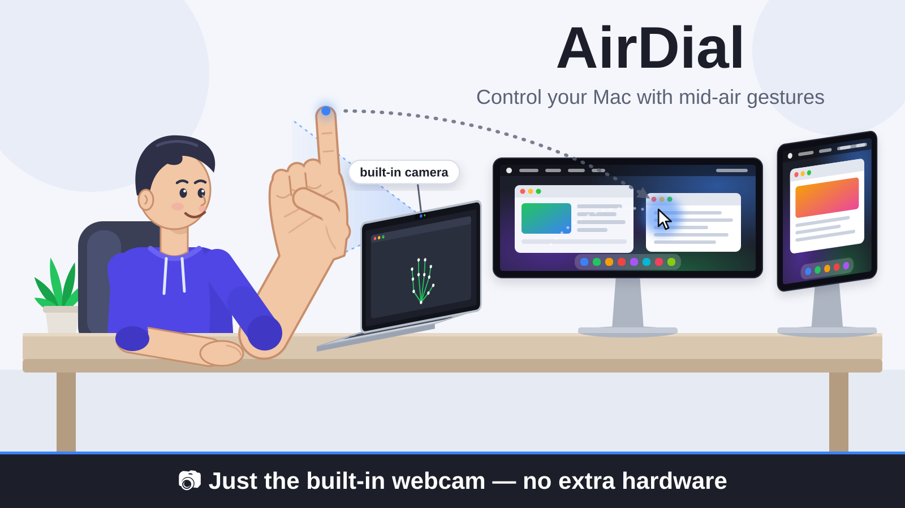</p>

## What you can do

☝️ **Point with your index finger.** The mouse cursor follows your fingertip, across all your displays (calibrated at start-up).

<p align="center">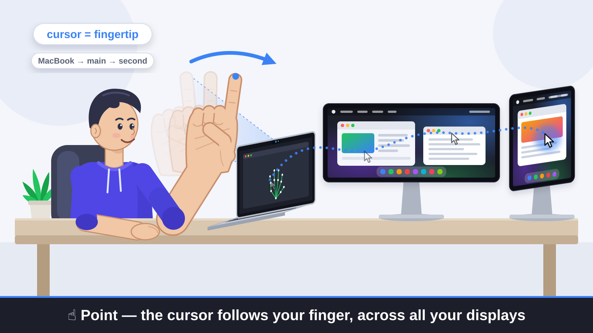</p>

**Tap your thumb tip on the middle finger's first knuckle** (the one by the fingertip). Left click.

<p align="center">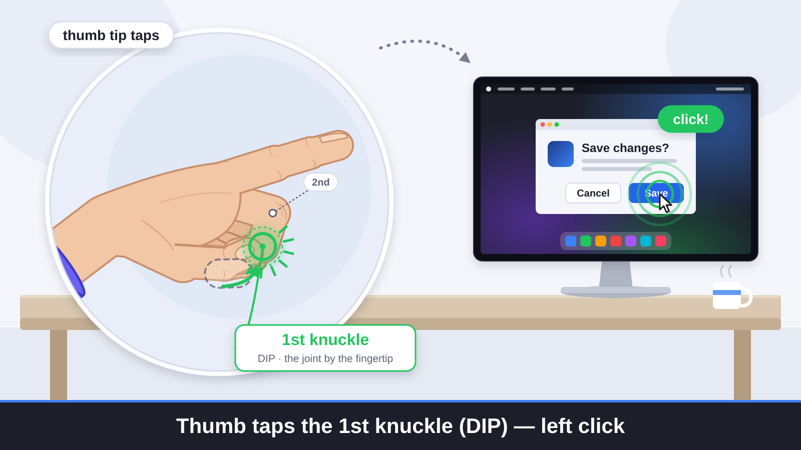</p>

**Tap your thumb tip on the middle finger's second knuckle.** Right click.

<p align="center">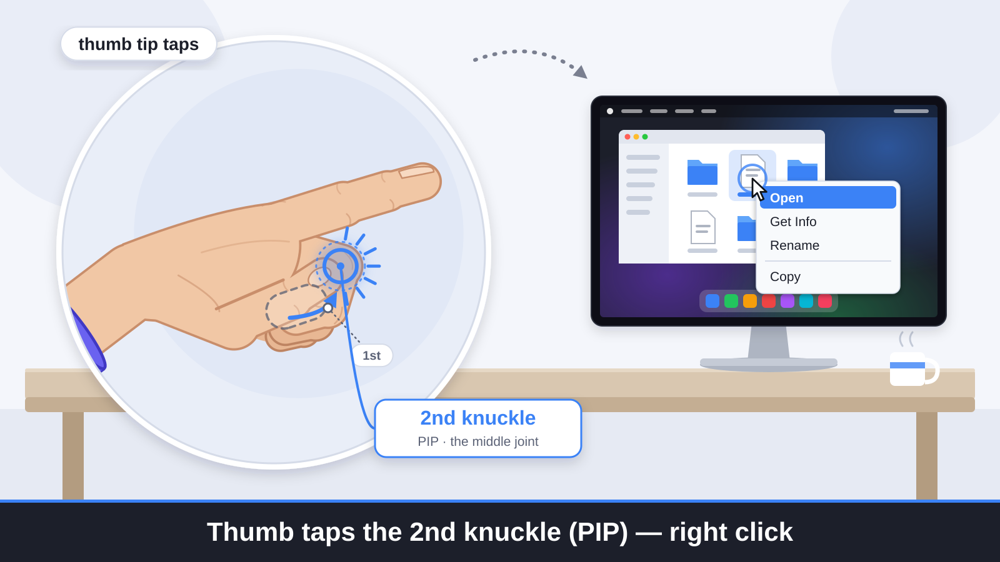</p>

**Slide your thumb along the middle finger.** Scrolls the page: towards the fingertip scrolls up, back towards the palm scrolls down.

<p align="center">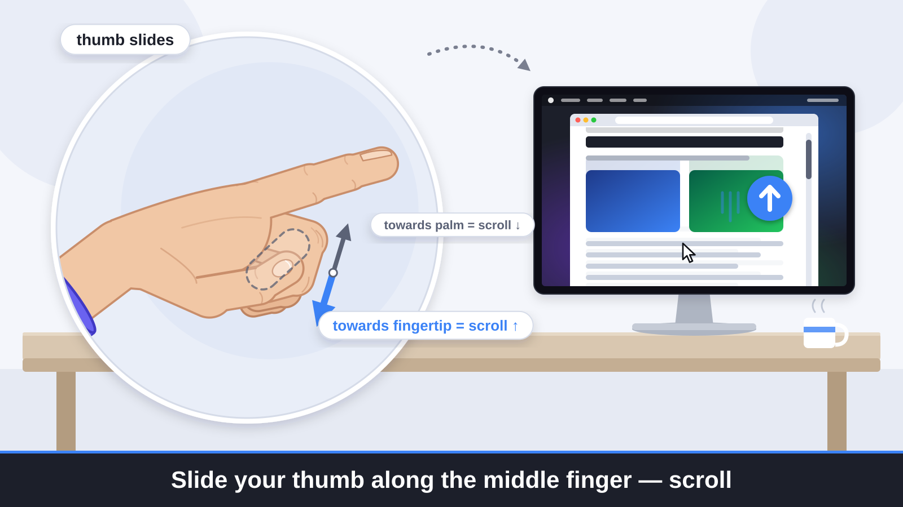</p>

🤞 **Hold index and middle finger together and draw circles.** Clockwise turns the volume up, counter-clockwise turns it down, one step per loop.

<p align="center">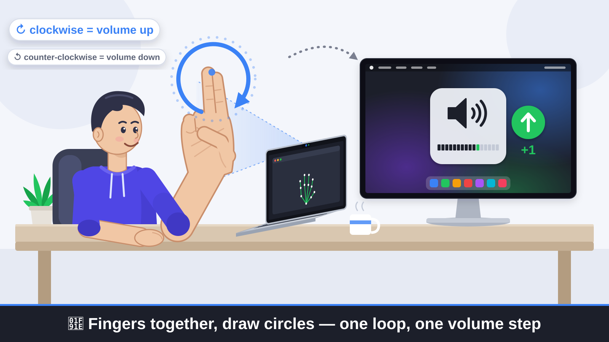</p>

✌️ **Make a V (fingers apart) and swipe quickly up or down.** Next track, in any player (Apple Music, Spotify, YouTube in a browser...).

<p align="center">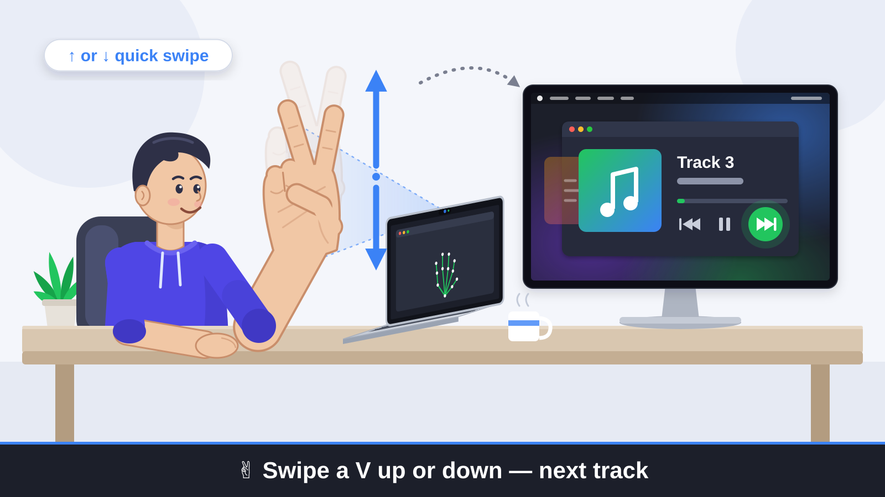</p>

🖐 **Show an open palm to the camera and swipe quickly sideways.** Swipe right for the desktop on the left, swipe left for the desktop on the right.

<p align="center">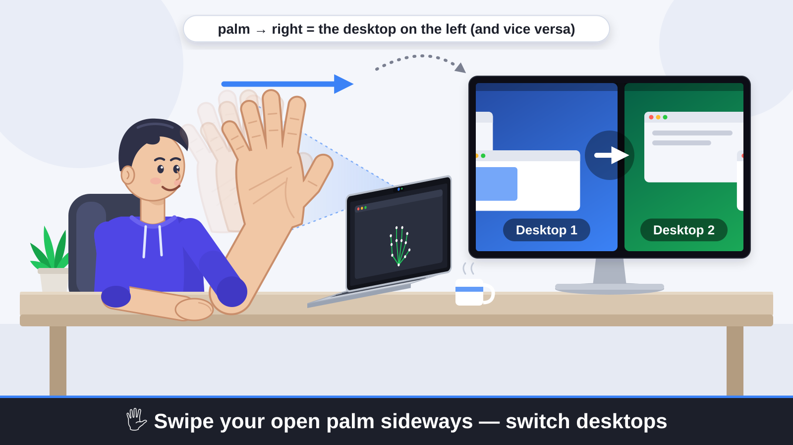</p>

🖐 **Open palm, swipe up or down.** Mission Control opens; do it again to close it.

<p align="center">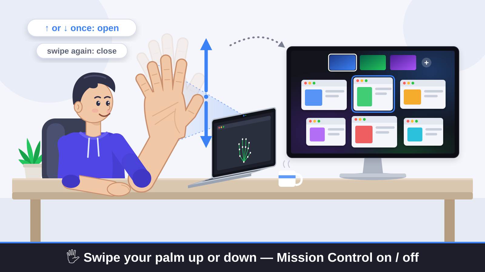</p>

✊→🖐 **Open a fist.** The front window goes full screen.  
🖐→✊ **Close your hand.** It leaves full screen.

<p align="center">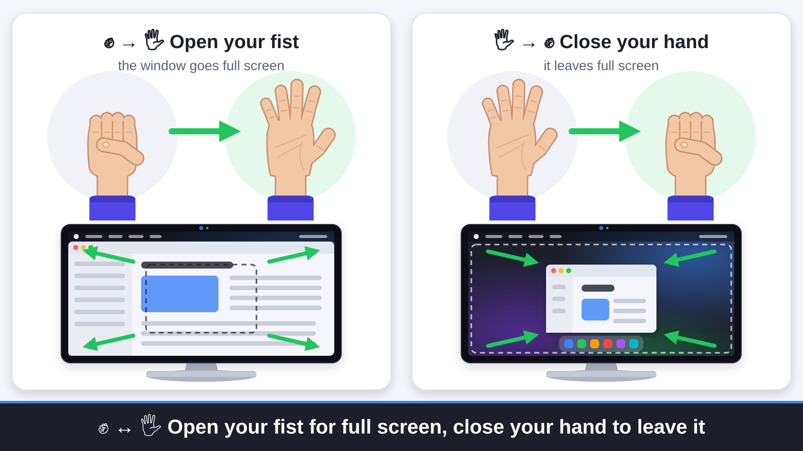</p>

👍 **Hold a thumbs-up.** AirDial holds down the Fn / 🌐 Globe key until you lower your thumb, so hold-to-talk dictation apps like Wispr Flow just work.  
Say **"AGI"** in your sentence (e.g. *"AGI, open tomorrow in my calendar"*) and AirDial removes the dictated text and hands the command to a Claude computer-use agent, which looks at the display under your cursor and carries it out. Press **Esc** to stop the agent.

<p align="center">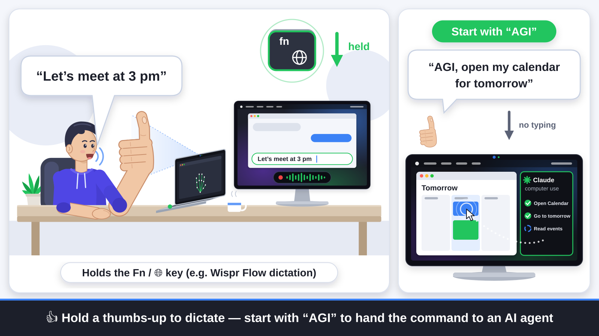</p>


## Install

You need macOS 12 or later (Apple Silicon recommended) and Xcode or the Command Line Tools (`xcode-select --install`).

```bash
git clone https://github.com/GuoShuyin/AirDial.git
cd AirDial
swift build -c release
```

**3D hand tracking** (recommended, makes every gesture more reliable). It runs offline on your Mac; camera frames never leave it.

```bash
python3 -m venv .venv && .venv/bin/pip install mediapipe numpy
mkdir -p models && curl -L -o models/hand_landmarker.task \
  https://storage.googleapis.com/mediapipe-models/hand_landmarker/hand_landmarker/float16/latest/hand_landmarker.task
```

**AI agent** (optional, for the "AGI" voice commands):

```bash
.venv/bin/pip install anthropic
open -e .env    # add a line ANTHROPIC_API_KEY=<your key> and save (touch .env first if it doesn't exist); git-ignored
```

Then start it:

```bash
.build/release/AirDial
```

A small preview window opens and shows what AirDial sees. Closing it quits AirDial.

## First run

### Permissions

macOS asks for a few permissions. They are granted to **the app you start AirDial from** (Terminal, iTerm, VS Code...), so enable that app in System Settings → Privacy & Security, then quit and reopen it.

| Permission | Needed for |
| --- | --- |
| **Camera** | Everything |
| **Accessibility** | Cursor, clicks, scrolling, switching desktops, full screen, the Fn key, and media keys for every player |
| **Microphone**, **Speech Recognition**, **Screen Recording** | Only for the "AGI" agent |

Switching desktops needs at least two desktops (Spaces), and uses macOS's standard Mission Control shortcuts (Control+← / → / ↑), so keep those enabled under System Settings → Keyboard → Keyboard Shortcuts → Mission Control.

### Calibration

<p align="center">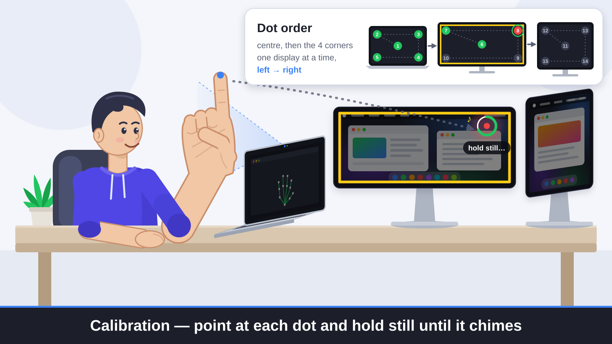</p>

So that the cursor lands where you point, AirDial calibrates at start-up:

1. Hold your index finger up in the middle of the camera picture. A 2-second countdown starts.
2. Dots appear at the centre and the four corners of each display, one display at a time, from left to right.
3. Point at each dot and hold still until it chimes.

Do it in the posture you'll use afterwards. Press **Cmd+R** at any time to recalibrate. The calibration is saved, and `--no-calibrate` skips it and reuses the last one.

## Options

Add any of these after `.build/release/AirDial`. `--help` lists them all.

| Option | What it does |
| --- | --- |
| **General** | |
| `--dry-run` | Recognise gestures but don't do anything (good for practising) |
| `--headless` | No preview window, runs in the background (Ctrl+C to quit) |
| `--sensitivity X` | `0.5` strict ... `1.5` sensitive (default `1.0`) |
| `--no-calibrate` | Skip the start-up calibration and reuse the last one |
| `--list-cameras` / `--camera NAME` | List cameras / use the camera whose name contains NAME |
| `--tracker vision` | Use Apple Vision (2D, less accurate) instead of 3D tracking |
| `--python PATH` / `--model PATH` | Use a different Python or hand model for 3D tracking |
| `--debug` | Print the recognised hand shape for every frame |
| **Cursor and clicks** | |
| `--no-cursor` | Don't move the cursor with your index finger |
| `--pinch-index` | Left click by tapping thumb and index fingertip instead |
| `--no-scroll` / `--scroll-reverse` | Turn off thumb scrolling / reverse its direction |
| **Music** | |
| `--ccw-up` | Counter-clockwise = volume up |
| `--circle-volume` | Also change the volume by circling one finger |
| `--knob` | Also change the volume by turning thumb, index and middle finger like a knob |
| `--vertical-prev` | V swipe up = next track, down = previous |
| `--swipe-down-next` | With `--vertical-prev`: down = next, up = previous |
| `--horizontal-tracks` | V swipe right / left = next / previous track |
| `--no-vertical` | Turn off V swipes up and down |
| **Desktops and windows** | |
| `--no-desktops` | Turn off all open-palm swipes |
| `--no-mission-control` | Turn off palm up / down = Mission Control |
| `--palm-follows` | Palm right = desktop on the right |
| `--palm-hold` | Stricter: hold the palm still for a moment before swiping |
| `--no-hand-shapes` | Turn off fist / open hand = full screen |
| `--no-thumbs-up` | Don't hold Fn / Globe on a thumbs-up |

## Tips

- **Light:** the more the better. A bright window behind you makes things noticeably worse.
- **Distance:** keep your hand 30–60 cm from the screen, and high enough that your **wrist is in the picture**.
- **Palm swipes:** show your palm flat to the camera and swipe crisply. The preview says "Ready: swipe now" when it sees the palm.
- **Clicks:** stop the cursor for a moment, then tap.
- **Full screen** acts on the front window, so click into the app you want first, not the AirDial preview.
- **Not reacting?** Look at the preview window: it shows the hand and gesture AirDial currently sees.

## License

[PolyForm Noncommercial 1.0.0](LICENSE): free for personal, educational, research and other noncommercial use, including changing it. **Commercial use requires a separate license from the author**; get in touch through [GitHub](https://github.com/GuoShuyin).

The MediaPipe hand model (`models/hand_landmarker.task`, downloaded separately) is Google's, under the Apache License 2.0.
