<p align="right"><a href="README.md">English</a> · <b>中文</b></p>

# AirDial

### 把《少数派报告》搬到你的 Mac 上：只用自带的摄像头，空手隔空操控电脑。

手指一指，光标跟着走，跨多块屏幕也行；指尖轻点就是点击，拇指一滑就能滚动；画个圈调音量，挥挥手切桌面；竖起大拇指就能说话输入，或者把说出的命令直接交给 AI 去执行。不需要任何额外硬件，手部识别全部在你的 Mac 本机完成。

<p align="center">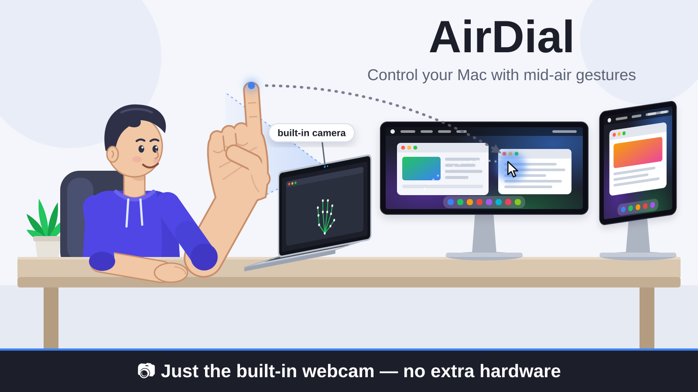</p>

## 能做什么

| | |
| --- | --- |
| 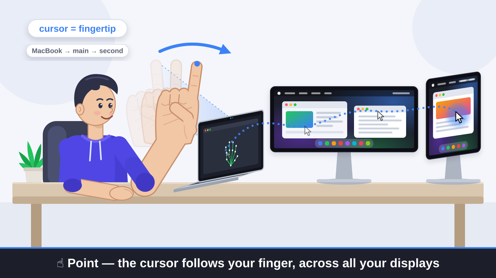 | ☝️ **伸出食指指着屏幕。** 鼠标光标跟着指尖走，多块显示器之间也能来回移动（启动时校准）。 |
| 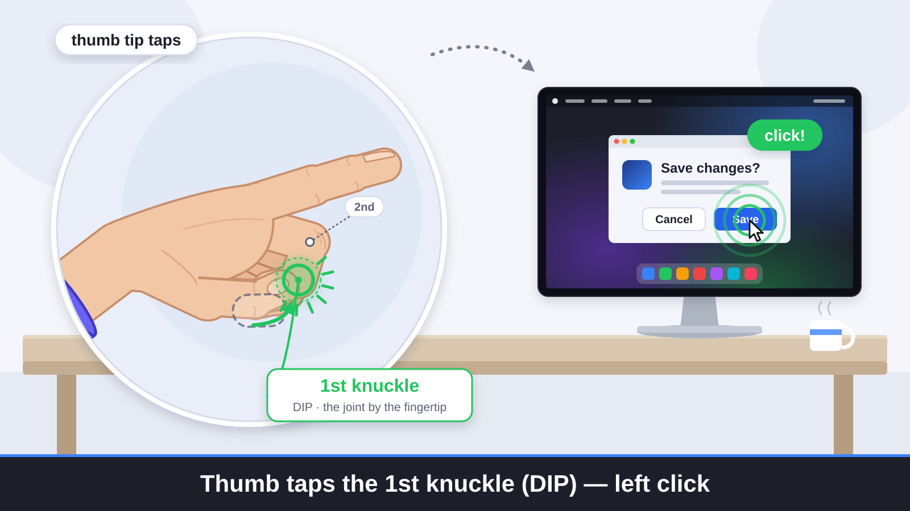 | **拇指尖点一下中指的第一指关节**（靠指尖的那个）。左键单击。 |
| 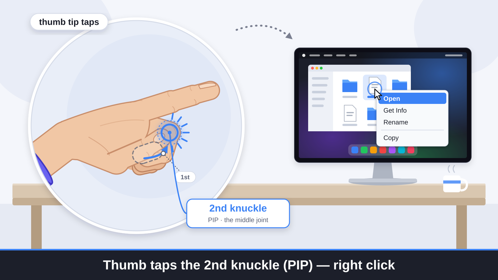 | **拇指尖点一下中指的第二指关节。** 右键单击。 |
| 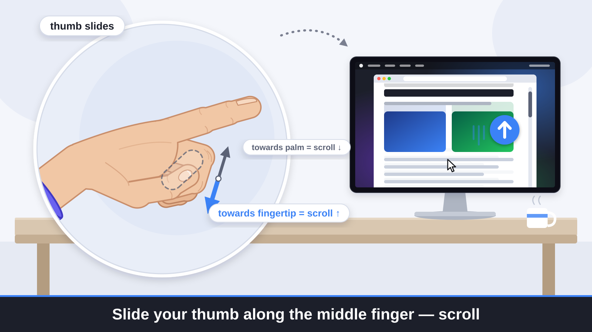 | **拇指贴着中指滑动。** 页面跟着滚动：往指尖方向滑是向上滚，往手掌方向滑是向下滚。 |
| 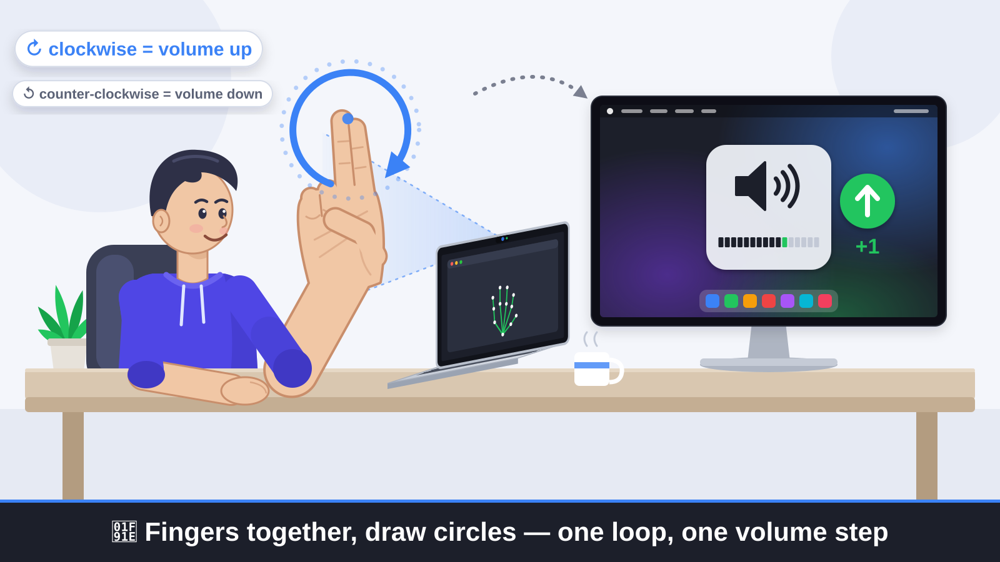 | 🤞 **食指和中指并拢，在空中画圈。** 顺时针加音量，逆时针减音量，每圈一格。 |
| 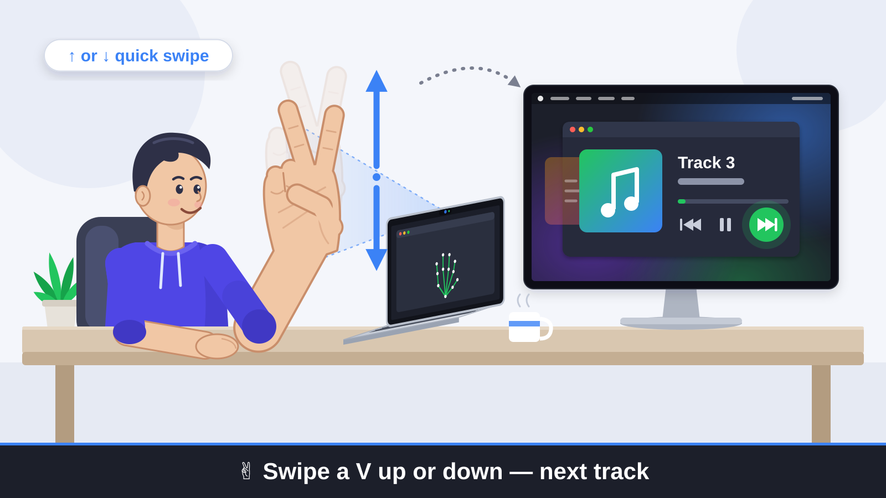 | ✌️ **比个 V（两指分开），快速向上或向下一划。** 切到下一首，Apple Music、Spotify、网页里的 YouTube 都行。 |
| 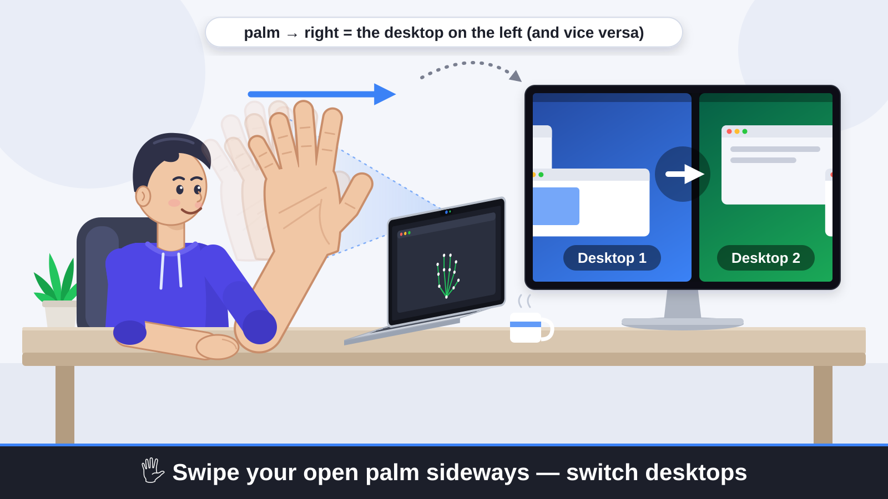 | 🖐 **张开手掌对着镜头，快速左右一挥。** 向右挥切到左边的桌面，向左挥切到右边的桌面。 |
| 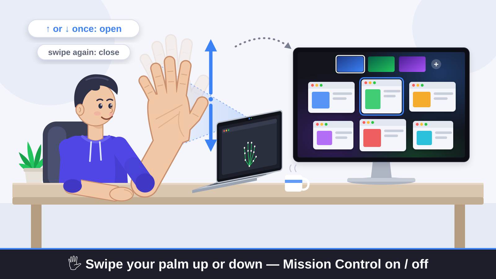 | 🖐 **张开手掌，向上或向下一挥。** 打开调度中心，再挥一次就关掉。 |
| 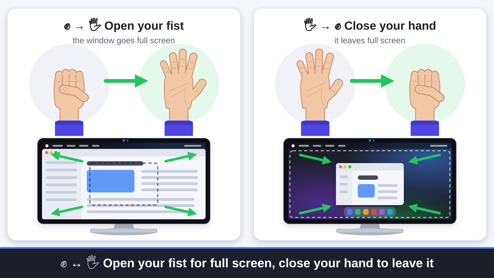 | ✊→🖐 **把拳头张开。** 最前面的窗口进入全屏。<br>🖐→✊ **把手握成拳。** 退出全屏。 |
| 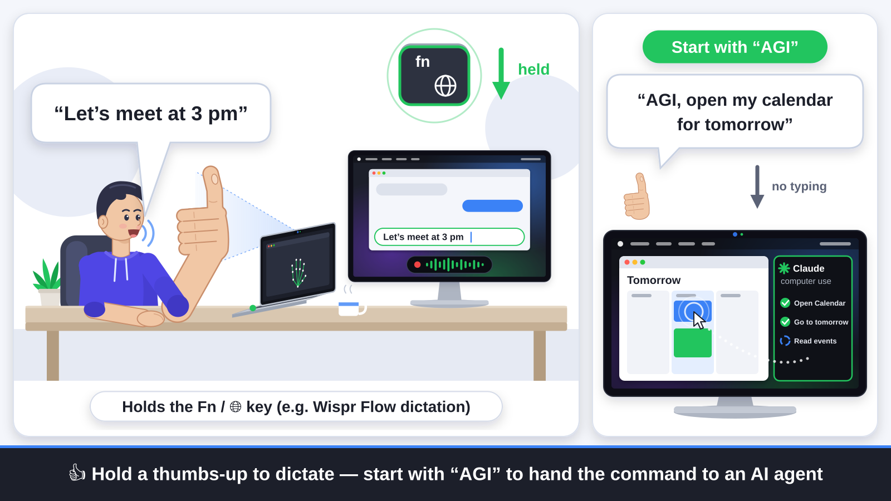 | 👍 **竖起大拇指不放。** AirDial 会一直按住 Fn / 🌐 地球键，放下大拇指才松开，Wispr Flow 这类"按住说话"的听写工具直接就能用。<br>话里带上 **"AGI"**（比如 *"AGI，在日历里打开明天"*），AirDial 会删掉刚听写出的文字，把这句指令交给 Claude 电脑操作代理：它看着光标所在的那块屏幕，替你把事情办完。按 **Esc** 可以随时叫停。 |

## 安装

需要 macOS 12 或更新版本（推荐 Apple Silicon），以及 Xcode 或 Command Line Tools（`xcode-select --install`）。

```bash
git clone https://github.com/GuoShuyin/AirDial.git
cd AirDial
swift build -c release
```

**3D 手部跟踪**（推荐装上，所有手势都会更稳）。它完全在本机离线运行，摄像头画面不会离开你的电脑。

```bash
python3 -m venv .venv && .venv/bin/pip install mediapipe numpy
mkdir -p models && curl -L -o models/hand_landmarker.task \
  https://storage.googleapis.com/mediapipe-models/hand_landmarker/hand_landmarker/float16/latest/hand_landmarker.task
```

**AI 代理**（可选，用来执行 "AGI" 语音指令）：

```bash
.venv/bin/pip install anthropic
open -e .env    # 在里面写一行 ANTHROPIC_API_KEY=你的 key，保存即可；没有这个文件就先 touch .env。它不会被提交到 git
```

然后运行：

```bash
.build/release/AirDial
```

会弹出一个小预览窗口，显示 AirDial 看到的画面。关掉这个窗口，AirDial 也就退出了。

## 第一次运行

### 权限

macOS 会请求几项权限，都是授予**你启动 AirDial 的那个 App**（Terminal、iTerm、VS Code 等）。在 系统设置 → 隐私与安全性 里打开它，然后完全退出并重新打开这个 App。

| 权限 | 用途 |
| --- | --- |
| **摄像头** | 所有功能 |
| **辅助功能** | 光标、点击、滚动、切换桌面、全屏、Fn 键，以及对所有播放器生效的媒体键 |
| **麦克风**、**语音识别**、**录屏** | 只有 "AGI" 代理需要 |

切换桌面至少要有两个桌面（空间），用的是 macOS 自带的调度中心快捷键（Control+← / → / ↑），请在 系统设置 → 键盘 → 键盘快捷键 → 调度中心 里保持开启。

### 校准

<p align="center">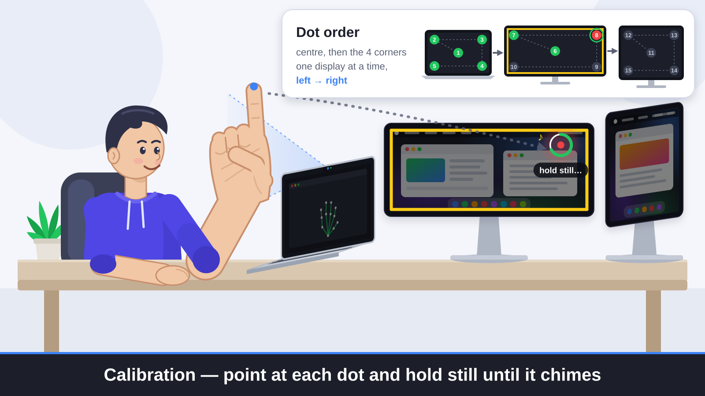</p>

为了让光标落在你指的地方，AirDial 每次启动时会先校准：

1. 把食指举到摄像头画面的中间，开始 2 秒倒数。
2. 每块屏幕的中心和四个角会依次出现圆点，一块屏幕接一块，从左到右。
3. 指着每个点停住不动，听到"叮"一声就是记下了。

校准时用你之后习惯的姿势来指。随时按 **Cmd+R** 可以重新校准。校准结果会保存下来，加上 `--no-calibrate` 就跳过校准、沿用上次的结果。

## 参数

加在 `.build/release/AirDial` 后面即可，`--help` 可以看到完整列表。

| 参数 | 作用 |
| --- | --- |
| **常用** | |
| `--dry-run` | 只识别手势、不执行，适合先练练手 |
| `--headless` | 不显示预览窗口，在后台运行（Ctrl+C 退出） |
| `--sensitivity X` | `0.5` 更严格 … `1.5` 更灵敏（默认 `1.0`） |
| `--no-calibrate` | 跳过启动校准，沿用上次的结果 |
| `--list-cameras` / `--camera 名字` | 列出摄像头 / 使用名字里包含"名字"的摄像头 |
| `--tracker vision` | 改用 Apple Vision（2D，准确度差一些），不用 3D 跟踪 |
| `--python 路径` / `--model 路径` | 为 3D 跟踪指定别的 Python 或手部模型 |
| `--debug` | 逐帧打印识别到的手型 |
| **光标和点击** | |
| `--no-cursor` | 不用食指控制光标 |
| `--pinch-index` | 左键改成拇指点食指指尖 |
| `--no-scroll` / `--scroll-reverse` | 关掉拇指滚动 / 反转滚动方向 |
| **音乐** | |
| `--ccw-up` | 逆时针画圈加音量 |
| `--circle-volume` | 同时允许单指画圈调音量 |
| `--knob` | 同时允许拇指、食指、中指像拧旋钮一样调音量 |
| `--vertical-prev` | V 字向上 = 下一首，向下 = 上一首 |
| `--swipe-down-next` | 配合 `--vertical-prev`：向下 = 下一首，向上 = 上一首 |
| `--horizontal-tracks` | V 字向右 / 向左 = 下一首 / 上一首 |
| `--no-vertical` | 关掉 V 字上下划 |
| **桌面和窗口** | |
| `--no-desktops` | 关掉所有手掌挥动 |
| `--no-mission-control` | 关掉手掌上下挥 = 调度中心 |
| `--palm-follows` | 反过来：手掌向右 = 切到右边的桌面 |
| `--palm-hold` | 更严格：手掌先停稳一下再挥 |
| `--no-hand-shapes` | 关掉握拳 / 张开 = 全屏 |
| `--no-thumbs-up` | 竖大拇指时不按 Fn / 地球键 |

## 小贴士

- **光线**越亮越好。背后是明亮的窗户（背光）时，效果会明显变差。
- **距离**：手离屏幕 30–60 cm，并且举得够高，让**手腕也在画面里**。
- **挥手掌**：手掌平着正对镜头，干脆地挥一下。预览窗口显示 "Ready: swipe now" 就说明认出手掌了。
- **点击**：先让光标停一下，再点。
- **全屏**作用于最前面的窗口，所以先点进你想操作的 App，别停在 AirDial 的预览窗口上。
- **没反应？** 看看预览窗口：AirDial 此刻认出的手和手势都显示在上面。

## License

[PolyForm Noncommercial 1.0.0](LICENSE)：个人、学习、研究等非商业用途可以免费使用，也可以修改。**商业用途需要另外取得作者授权**，请通过 [GitHub](https://github.com/GuoShuyin) 联系。

MediaPipe 手部模型（`models/hand_landmarker.task`，需要单独下载）属于 Google，采用 Apache License 2.0。
